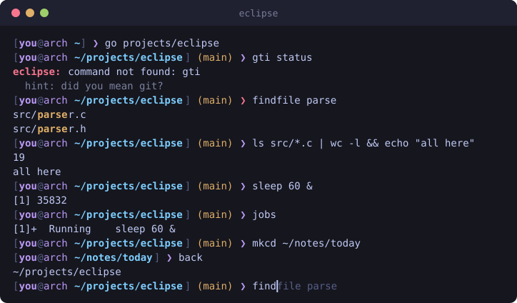

# Eclipse

**A friendly, modern Unix shell for Linux, written in C.**



Eclipse runs the Linux commands you already know (pipes, redirection, job
control and all) and adds plain-language shortcuts, suggestions as you type,
and error messages that tell you what to do next. It is a single small
binary with no dependencies beyond the C library.

Eclipse installs as a separate program called `eclipse`. It never touches
your login shell or its configuration.

## Contents

- [Features](#features)
- [Install on Arch Linux](#install-on-arch-linux)
- [Quick start](#quick-start)
- [Everyday commands](#everyday-commands)
- [Shell features](#shell-features)
- [Keys](#keys)
- [Customising](#customising)
- [What Eclipse is not](#what-eclipse-is-not)
- [Testing](#testing)
- [Uninstall](#uninstall)
- [Contributing](#contributing)
- [Licence](#licence)

## Features

**A shell you can use every day**

- Runs any program, with pipes (`|`), redirection (`>`, `>>`, `<`, `2>`,
  `&>`, `2>&1`, `<<<`) and chaining (`&&`, `||`, `;`).
- Job control: background jobs (`&`), `jobs`, `fg`, `bg`, `kill %1`, `wait`,
  Ctrl+C and Ctrl+Z.
- Variables and the environment: `NAME=value`, `export`, `$NAME`,
  `${NAME:-default}`, `$?`, `$(command)`, `$((2 + 2))`.
- Quoting and escaping as in other shells; wildcards (`*.txt`), `~`, and
  braces (`file.{c,h}`, `{1..5}`).
- Aliases, `source`, scripts (`eclipse script.ecl`) and `eclipse -c '...'`.

**Human-friendly**

- Plain-language commands: `go`, `up`, `back`, `whereami`, `mkcd`,
  `findfile`, `extract`, `recent`, `sysinfo`.
- Suggestions for mistyped commands and folders ("did you mean git?").
- Error messages with a hint about what to try.
- `help` lists everything; `help COMMAND` explains one command.

**A pleasant prompt**

- Grey inline suggestions from your history as you type; press Right to
  accept.
- Tab completion for commands, files, folders, variables and settings.
- History that persists between sessions, searchable with Ctrl+R or by
  typing the start of a command and pressing Up.
- The current git branch in the prompt, read directly from `.git` (no
  `git` process is started, so the prompt stays instant).
- A prompt symbol that turns red when the last command failed.
- Customisable prompt and colours in `~/.config/eclipse/config`.

**Careful by design**

- Pasted text is never run until you press Enter, and control characters
  in it are shown, not obeyed.
- The history file is private (mode 600); commands typed with a leading
  space are not recorded.
- A config file that belongs to someone else, or that anyone can write
  to, is refused.
- Built-in commands run programs directly, never through `system()`.

## Install on Arch Linux

You need a C compiler and `make`:

```sh
sudo pacman -S --needed base-devel
```

Build, test and install. Installation goes to `~/.local` and does **not**
need root:

```sh
git clone https://github.com/<your-username>/eclipse.git
cd eclipse
make
make test             # optional: runs all three test suites
make install          # installs ~/.local/bin/eclipse and the man page
make install-config   # optional: creates ~/.config/eclipse/config
```

Then start it:

```sh
eclipse
```

If the command is not found, `~/.local/bin` is not in your `PATH`. Add this
line to your current shell's startup file (for bash, `~/.bashrc`):

```sh
export PATH="$HOME/.local/bin:$PATH"
```

`extract` uses the usual tools. `tar`, `gzip`, `bzip2`, `xz` and `zstd` are
part of a normal Arch install; for the others:

```sh
sudo pacman -S --needed unzip 7zip unrar
```

To install system-wide instead: `sudo make install PREFIX=/usr/local`.

> **Name clash:** the Eclipse IDE also installs a command called `eclipse`.
> If you have it, whichever comes first in your `PATH` wins. Install this
> shell under another name with
> `install -m 755 eclipse ~/.local/bin/eclipse-shell`.

### Your existing shell is left alone

`make install` copies three files into `~/.local` and nothing else. It does
not run `chsh`, edit `/etc/shells`, or modify `~/.bashrc` or any other
startup file. You start Eclipse by typing `eclipse` and return to your
normal shell with `exit` or Ctrl+D.

## Quick start

```sh
eclipse                 # start an interactive session
help                    # list every built-in command
help findfile           # explain one of them
exit                    # or press Ctrl+D
```

A few things to try:

```sh
go Downloads            # change directory (falls back to ~/Downloads)
findfile invoice        # files with "invoice" in the name, any case
mkcd projects/demo      # create the folder and enter it
back                    # return to where you were
ls -la | grep conf > found.txt
sleep 60 &              # run in the background
jobs                    # see it
```

## Everyday commands

| Command | What it does |
|---|---|
| `go FOLDER` | Change directory. With no argument, go home. If the folder is not here, Eclipse also tries ignoring case and looking in your home folder, and tells you where it went. Words are joined, so `go My Folder` works without quotes. |
| `up [N]` | Move up one directory, or `N` directories. |
| `back` | Return to the directory you were in before. Repeat it to keep walking back. |
| `whereami` | Show the current directory. |
| `mkcd FOLDER` | Create a directory (and any missing parents) and enter it. |
| `findfile NAME [FOLDER]` | Find files whose name contains `NAME`, ignoring case. Wildcards work when quoted: `findfile '*.pdf' ~/Documents`. |
| `extract ARCHIVE...` | Unpack `.tar`, `.tar.gz`, `.tgz`, `.tar.bz2`, `.tar.xz`, `.tar.zst`, `.zip`, `.gz`, `.bz2`, `.xz`, `.zst`, `.7z` or `.rar`. |
| `recent [N]` | Show your most recent commands, newest first, without repeats. |
| `sysinfo` | Show the OS, kernel, uptime, CPU, memory and disk usage. |

The standard built-ins are here too: `cd`, `pwd`, `echo`, `export`, `unset`,
`alias`, `unalias`, `history`, `source`, `type`, `exec`, `exit`, `jobs`,
`fg`, `bg`, `wait`, `kill`, `set` and `help`.

## Shell features

```sh
# Pipes and redirection
cat access.log | grep 404 | wc -l
make > build.log 2>&1
sort < names.txt >> sorted.txt
grep -r TODO . &> results.txt
tr a-z A-Z <<< "shout this"

# Chaining
make && ./run-tests || echo "build or tests failed"
cd /tmp; ls

# Background and foreground
long-task &            # prints [1] and the process id
jobs                   # [1]+  Running    long-task &
fg                     # bring it back; Ctrl+Z suspends it again
bg                     # let it continue in the background
kill %1

# Variables
NAME=world
echo "hello $NAME, you have ${#NAME} letters"
export EDITOR=nano
LANG=C sort file.txt          # set a variable for one command only
echo "${EDITOR:-vi}"

# Substitution and arithmetic
echo "today is $(date +%A)"
echo "$((7 * 6))"

# Wildcards and braces
ls *.txt
cp config.{json,json.bak}
mkdir -p project/{src,tests,docs}
echo {1..5}

# Quoting
echo 'single quotes keep $everything literal'
echo "double quotes expand $HOME"
touch my\ file.txt

# Aliases
alias gs='git status'
alias                         # list them
unalias gs

# Repeat the last command
sudo !!
```

Aliases take effect from the next line, as in bash.

## Keys

| Key | Action |
|---|---|
| Tab | Complete a command, file, folder, `$VARIABLE` or setting; if several match, list them |
| Right, End | Accept the grey suggestion |
| Ctrl+Right, Alt+F | Accept the next word of the suggestion, or move forward a word |
| Up, Down | Previous / next command. If you have typed something, only commands starting with it |
| Ctrl+R | Search the history; Ctrl+R again for older matches |
| Ctrl+A, Ctrl+E | Start / end of the line |
| Alt+B, Ctrl+Left | Back one word |
| Ctrl+W, Ctrl+U, Ctrl+K | Delete the previous word / to the start / to the end |
| Ctrl+Y | Paste what was last deleted |
| Ctrl+L | Clear the screen |
| Ctrl+C | Abandon the line, or stop the running command |
| Ctrl+Z | Suspend the running command (`fg` resumes it) |
| Ctrl+D | Exit, on an empty line |

If a quote is left open, or a line ends with `|`, `&&`, `||` or `\`,
Eclipse shows a continuation prompt and waits for the rest.

## Customising

Eclipse reads `~/.config/eclipse/config` when an interactive session
starts. The file contains ordinary Eclipse commands, so you can try a line
at the prompt first and copy it in when you like it. `make install-config`
creates a commented starter file; see
[`config/config.example`](config/config.example).

```sh
# ~/.config/eclipse/config
alias ll='ls -lh --color=auto'
export EDITOR=nano

set prompt '%{path}%w%{reset}%g %s '
set color.path 'bold #7aa2f7'
set symbol '➜'
```

### Settings

Run `set` to list every setting with its current value, `set KEY` to show
one, and `set KEY VALUE` to change one.

| Setting | Default | Meaning |
|---|---|---|
| `prompt` | `[user@host dir] (branch) ❯` | Prompt format (see below) |
| `prompt2` | `... ❯` | Continuation prompt format |
| `symbol` | `❯` | What `%s` prints (`>` outside UTF-8 locales) |
| `git_prefix`, `git_suffix` | ` (` and `)` | Text around the branch name |
| `color.user`, `color.host`, `color.path`, `color.git`, `color.symbol`, `color.error`, `color.bracket`, `color.suggestion` | | Theme colours |
| `color` | `on` | Use colour at all |
| `autosuggest` | `on` | Grey suggestions from history while typing |
| `suggest_commands` | `on` | "Did you mean" for mistyped commands |
| `history_size` | `5000` | Number of commands remembered |

### Prompt format

| Code | Meaning | Code | Meaning |
|---|---|---|---|
| `%u` | user name | `%h` | host name |
| `%w` | directory, with `~` for home | `%W` | last part of the directory |
| `%d` | directory, full path | `%g` | git branch, with prefix and suffix |
| `%s` | prompt symbol | `%?` | last exit status |
| `%t` | time `HH:MM` | `%T` | time `HH:MM:SS` |
| `%j` | number of jobs | `%n` | new line |
| `%%` | a literal `%` | `%{NAME}` | switch colour |

`%{NAME}` takes a theme colour (`user`, `host`, `path`, `git`, `symbol`,
`error`, `bracket`, `suggestion`), `reset`, or any colour.

### Colours

A colour is `black`, `red`, `green`, `yellow`, `blue`, `magenta`, `cyan`,
`white`, any of those with `bright-` in front, a number from 0 to 255, or
`#rrggbb`. Put `bold`, `dim`, `italic`, `underline` or `reverse` before it:
`set color.git 'bold bright-yellow'`.

The defaults use your terminal's own 16 colours, so Eclipse follows your
terminal theme. Setting the `NO_COLOR` environment variable turns colour
off.

### Files

| Path | Purpose |
|---|---|
| `~/.config/eclipse/config` | Configuration (honours `XDG_CONFIG_HOME`) |
| `~/.local/share/eclipse/history` | Command history (honours `XDG_DATA_HOME`; `ECLIPSE_HISTORY` overrides) |

## What Eclipse is not

Eclipse is an interactive shell, not a scripting language. It deliberately
leaves these out:

- `if`, `for`, `while`, `case` and functions
- here-documents (`<<EOF`); here-strings (`<<<`) are supported
- subshell groups `( ... )` and `{ ...; }`
- `${NAME%pattern}`-style trimming, arrays and `$'...'` strings

Scripts that start with `#!/bin/sh` or `#!/bin/bash` run exactly as before
when launched from Eclipse, because Linux hands them to the interpreter
they name. For anything that needs logic, write it in one of those and run
it from Eclipse.

Eclipse is developed and tested on Arch Linux with glibc. It uses a few
Linux and GNU features and is not expected to build elsewhere unchanged.

## Testing

```sh
make test
```

runs three suites:

| Suite | What it covers |
|---|---|
| `make test-unit` | C unit tests of the lexer, parser, expansion, arithmetic, history, completion, prompt, settings and suggestions |
| `make test-integration` | Real command lines through `eclipse -c`, checking output and exit status |
| `make test-pty` | A pseudo-terminal that types at Eclipse: editing keys, Tab, history, paste, Ctrl+C, Ctrl+Z, `fg` and `bg` |

The tests use a temporary `HOME` and never read or write your real config
or history. `make test-debug` repeats all three under AddressSanitizer and
UndefinedBehaviorSanitizer.

## Uninstall

```sh
make uninstall
```

This removes the binary, man page and example config. Your own config and
history are left in place; delete `~/.config/eclipse` and
`~/.local/share/eclipse` if you no longer want them.

## Contributing

Bug reports and patches are welcome. See [CONTRIBUTING.md](CONTRIBUTING.md)
for how to build, test and submit changes, and
[DEVELOPMENT.md](DEVELOPMENT.md) for how the code is organised.

## Licence

[MIT](LICENSE)
